# Awesome Web Prompts

> 收集互联网上优质的网页开发资源，包括 AI 提示词、现成源码与可运行 HTML 演示。

[](https://awesome.re)

[English](README_EN.md) | 中文 | [可运行演示列表](catalog/demos.md) | [JSON 元数据索引](catalog/index.json)

## 简介

当前共收录 **84** 个条目（完整页面 **57** · 页面区块 **25** · UI 组件 **2**），其中包含 **19** 个可直接打开的 `index.html` 演示。

- **Prompt** — 面向 Claude、GPT、Gemini、Cursor 等 AI 编程工具的结构化提示词，复制即可生成完整网页
- **Source Code** — 开箱即用的网页源代码，可直接运行或作为二次开发起点

## 分类导航

- **完整页面**: [Landing Pages](#landing-pages) (8) · [AI, SaaS & Tech](#ai-saas-tech) (9) · [Creative, 3D & Motion](#creative-3d-motion) (8) · [Portfolio, Agency & Culture](#portfolio-agency-culture) (13) · [Brand, Commerce & Lifestyle](#brand-commerce-lifestyle) (8) · [Fintech, Mobility & Industry](#fintech-mobility-industry) (5) · [Auth, Onboarding & 404](#auth-onboarding-404) (6)
- **页面区块**: [Hero Sections](#hero-sections) (21) · [Footer Sections](#footer-sections) (3) · [Contact Sections](#contact-sections) (1)
- **UI 组件**: [UI Components & Effects](#ui-components-effects) (2)

## 目录

### 完整页面

包含完整多区块布局、视口叙事或独立功能流程的整页设计。

#### Landing Pages

包含首屏、特性展示、产品介绍与页脚的完整营销落地页。

| 名称 | 类型 | 演示 | 说明 | 预览 |
|------|------|------|-------------|---------|
| [3D Story](collection/3d-story/) | Source Code | - | 滚动驱动视频帧逐帧播放 + 粒子系统 + 卡片渐进揭示，沉浸式 3D 框架营销页 | 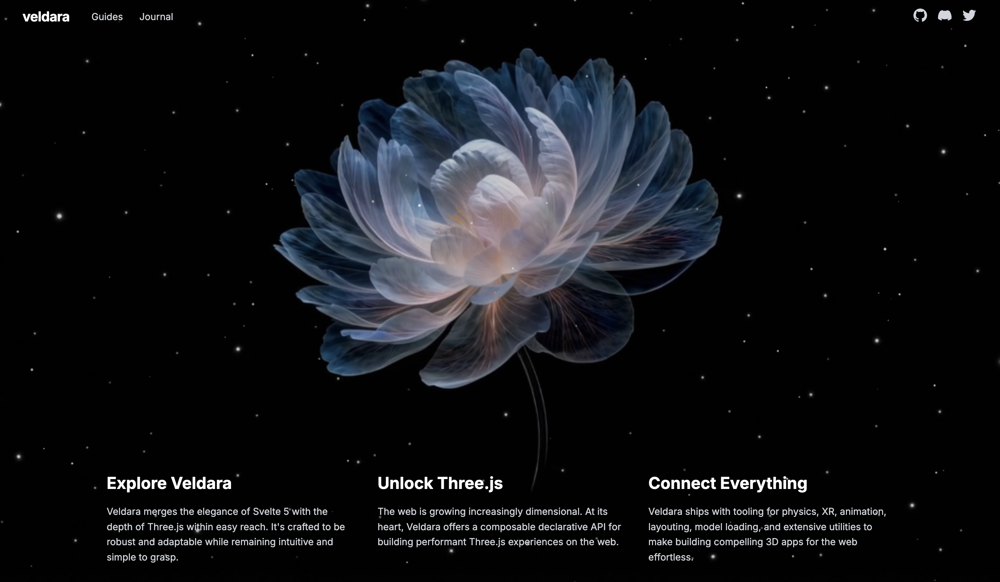 |
| [AI Designer Portfolio](collection/ai-designer-portfolio/) | Prompt | - | 鼠标跟随 GIF 粒子特效 + 视差图片 + 自动滚动推荐轮播，独立设计师作品集落地页 | - |
| [Health Portal](collection/health-portal/) | Prompt | - | 极致大图遮罩拼接（Masked Cards）与滚动视差，单页牙科医疗落地页 | 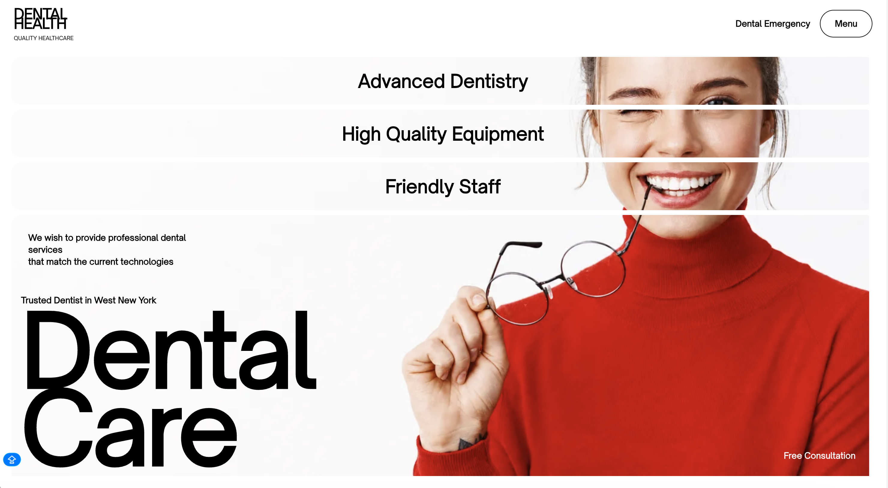 |
| [Innovation](collection/innovation/) | Prompt | - | 高阶 Liquid Glass 材质 + 原生 JS 控制的视频无缝黑场过渡，五段式创新企业落地页 | - |
| [Orbis NFT](collection/orbis-nft/) | Prompt | - | 顶级 Liquid Glass 特效 + 全局噪点层 + 深空多视频拼接，暗黑系 NFT 落地页 | - |
| [Prisma Creative Studio](collection/prisma-creative-studio/) | Prompt | - | 电影质感暗黑调色 + SVG 噪点背景 + 文字逐词上浮进场，三段式创意工作室落地页 | 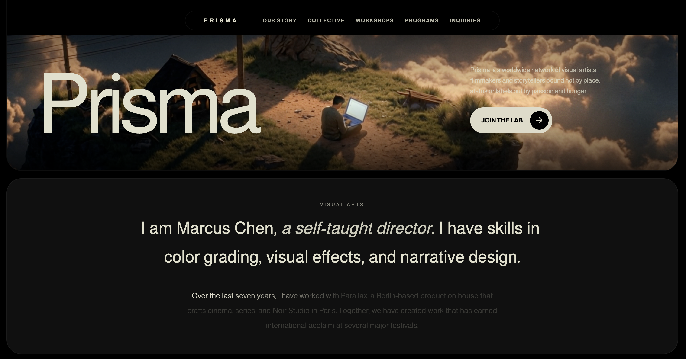 |
| [SkyElite Private Jets](collection/skyelite-private-jets/) | Prompt | - | 极简高冷灰调，重叠排版与全屏视频交织的高端服务落地页 | - |
| [USD Halo](collection/usd-halo/) | Prompt | - | 稳定币产品金融科技落地页，圆角内嵌视频 Hero + 品牌字体差异化走马灯 | - |

#### AI, SaaS & Tech

人工智能系统、SaaS 云平台、数据智能、网络安全与硬核科技应用落地页。

| 名称 | 类型 | 演示 | 说明 | 预览 |
|------|------|------|-------------|---------|
| [ADHD Planner (Drift)](collection/adhd-planner/) | Prompt | - | 极简温润风 ADHD 友好日程规划应用 Drift 落地页，全屏视频 Hero、奶油色 About 区块与滚动联动卡片。 | - |
| [Agent Wave (Vesper.ai)](collection/agent-wave/) | Prompt | - | 单文件无依赖极简纯黑单屏 AI 落地页，液态金属胶囊导航、Instrument Serif 混排标题与自适应统计底栏。 | - |
| [AI Runtime](collection/ai-runtime/) | Prompt | - | 单屏沉浸式全景视频背景 AI 落地页，采用复古点阵字体与精细的统计计数器动画。 | - |
| [Cyber Layer](collection/cyber-layer/) | Prompt | - | 单文件无依赖网络安全暗黑单屏落地页，双层调色 LUT 滤镜视频背景、Space Grotesk 字体排版与 WAAPI 逐帧进场动效。 | - |
| [Cyber Ronin](collection/cyber-ronin/) | Prompt | - | 单文件无依赖赛博朋克全视口Hero落地页，双层画面鼠标聚光灯探照揭示、逐词上浮动画与6级响应式断点体系。 | - |
| [Fastshot](collection/fastshot/) | Prompt | - | 单文件无依赖极简高质感 AI 应用生成平台 Fastshot 落地页，全屏晨曦视频背景、像素级精准 Composer 提示词卡片与三端自适应架构。 | - |
| [Intelligent Performance](collection/intelligent-performance/) | Prompt | - | 单文件无依赖SaaS高性能全视口营销舞台，双端自适应视频背景、LED点阵字型生成器与3张429×554毛玻璃指标卡 | - |
| [Quantum Core (Apogee)](collection/quantum-core/) | Prompt | - | 深空星云视频背景 + 毛玻璃营收增长图表卡片 + 纯 CSS 逐条生长柱状图，Apogee 数据智能 Hero 落地页 | - |
| [Signal ID](collection/signal-id/) | Prompt | - | 技术品牌的全屏深色英雄落地页，包含右侧注册表单和电影级背景视频。 | - |

#### Creative, 3D & Motion

沉浸式 3D 体验、滚动视频叙事、宇宙探索与前沿动态交互页面。

| 名称 | 类型 | 演示 | 说明 | 预览 |
|------|------|------|-------------|---------|
| [Autumn Fox](collection/autumn-fox/) | Prompt | [HTML](collection/autumn-fox/index.html) | FENNEC AI 自动化全屏 3D Hero 落地页——Three.js 交互式秋季红狐狸模型、悬浮缓动视差、暖色调视频背景与胶囊变形抽屉菜单 | - |
| [ConSentinel](collection/consentinel/) | Prompt | - | 单文件无依赖数字安全全视口页面，--u基准设计度量、WAAPI编排入场与视口宽高比三级响应式几何 | - |
| [Nebula Hero](collection/nebula-hero/) | Prompt | [HTML](collection/nebula-hero/index.html) | Orbit 太空探索全屏英雄落地页——1563×1006 刚性 --u 度量系统、环行星 SVG 矢量图形、9s 循环星空视频、双行文本遮罩揭示与 1.7s 入场动画 | - |
| [Runway Lookbook](collection/runway-lookbook/) | Prompt | [HTML](collection/runway-lookbook/index.html) | Maison Vell 时尚秀场画册全视口页面——单状态变量 p 驱动、7 阶非线性空间深度插值表、双 SVG 精准切片雪碧图与流体拖拽吸附联动 | - |
| [Space Planet](collection/space-planet/) | Prompt | - | 单文件无依赖沉浸式宇宙天体全视口页面，三大行星高清微动视频无缝切换、--u绝对设计度量与双侧透明切片微交互 | - |
| [Space Voyage](collection/space-voyage/) | Prompt | [HTML](collection/space-voyage/index.html) | 星球穿越门户体验——全屏视频预加载器、Canvas 假透视圆角矩形门户、指针驱动视角倾斜、帧冻结转场、Mars/Earth/Venus 状态机 | - |
| [Sparkform](collection/sparkform/) | Prompt | - | 极具创意的落地页，包含层叠的 3D 文字效果、滚动驱动动画以及无限滚动的跑马灯。 | - |
| [Vectrus Energy](collection/vectrus-energy/) | Prompt | - | 电影级滚动驱动视频单页网站，基于 WebCodecs + MP4Box 离线解码平滑帧缓冲（Scrubbing），搭配 Helvetica Neue ME 极简排版与 500vh 叙事长卷。 | - |

#### Portfolio, Agency & Culture

个人作品集、创意机构工作室、艺术画廊与自然摄影档案网站。

| 名称 | 类型 | 演示 | 说明 | 预览 |
|------|------|------|-------------|---------|
| [3D Portfolio](collection/3d-portfolio/) | Prompt | - | 3D 创作者作品集，包含磁性悬停、无限走马灯与粘性卡片堆叠等多种高阶交互 | 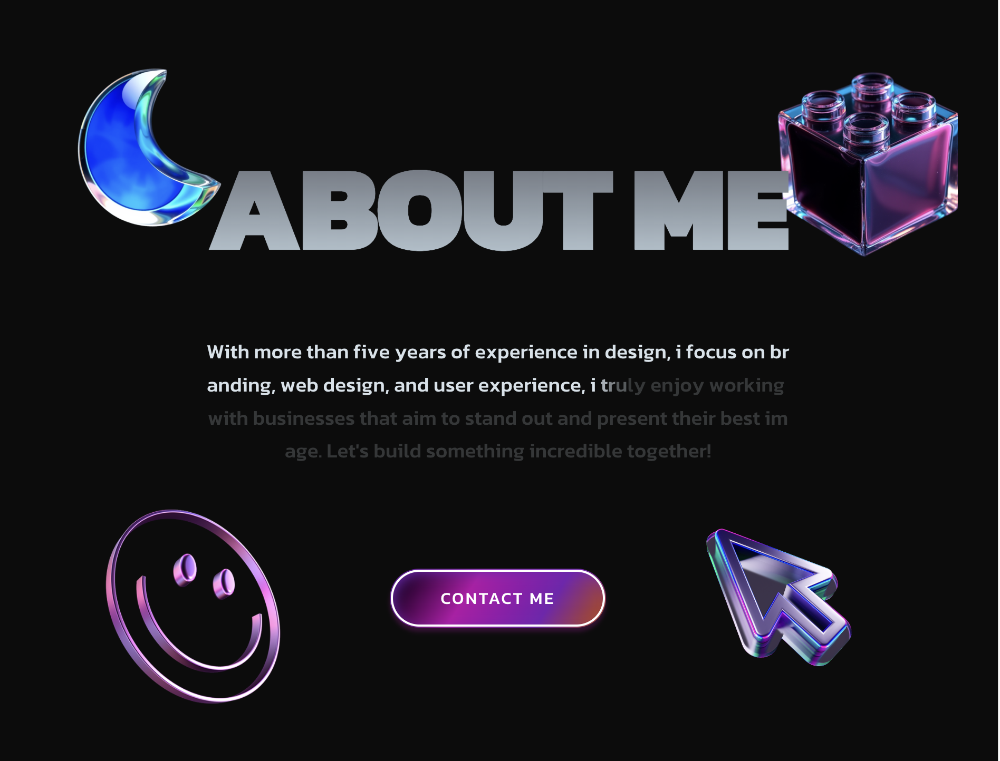 |
| [Atrium MTL](collection/atrium-mtl/) | Prompt | [HTML](collection/atrium-mtl/index.html) | ATRIUM MTL 蒙特利尔野兽派建筑与艺术摄影档案馆——悬浮白卡导航栏、超大粗衬线文字遮罩揭示、六列错位无缝垂直滚动漫游马赛克与 WAAPI 精准入场交接系统 | - |
| [AXON](collection/axon/) | Prompt | [HTML](collection/axon/index.html) | AXON 动态研究实验室全屏暗黑落地页——26 万 GPGPU 粒子雕塑、Navier-Stokes 流体模拟光标涡流扰动与 Monospace 极简排版 | - |
| [Digital Director](collection/digital-director/) | Prompt | - | 创意总监/工程师 Adam Roberts 全屏作品集，像素位图字体混排 + 背景视频 + 四列信息网格 + 获奖芯片 | - |
| [Gold Standard](collection/gold-standard/) | Prompt | [HTML](collection/gold-standard/index.html) | SOSCALE 黄金标准全视口英雄落地页——SVG 文字遮罩镂空视频背景、1280 刚性 --u 度量系统、JS 焦点锚定封面自适应算法、Web Animations API 阶梯起落入场动效 | - |
| [Nature Portfolio](collection/nature-portfolio/) | Prompt | [HTML](collection/nature-portfolio/index.html) | 野生动物摄影档案馆，Fibonacci 球体排布21张照片、16vh 滚动推进镜头、FLIP 灯箱、全屏菜单与自定义光标 | - |
| [Neo Museum (NHM)](collection/neo-museum/) | Prompt | - | 自然历史博物馆 (NHM) 沉浸式前沿多章节落地页，SVG 多边形字形入场、SVG 滤镜沙化过渡动效与黑白无缝分段切换。 | - |
| [Parallax](collection/parallax/) | Prompt | [HTML](collection/parallax/index.html) | PARALLAX 全视口作品集落地页——1280×800 双重缩放系统（--sc / --u）、12 条高精度圆弧环线 SVG 遮罩层、WAAPI 物理出场编排动效与响应式微交互 | - |
| [Playful Idea](collection/playful-idea/) | Prompt | - | 创意工作室单页页脚，薰衣草毛绒玩偶视频背景、指针凝视视线视频帧洗刷交互与三栏极简排版 | - |
| [Portfolio Cosmic](collection/portfolio-cosmic/) | Prompt | - | 高阶暗黑个人作品集，内置 HLS 视频流背景与 GSAP 深度视差滚动探索区 | - |
| [Print Ring (OMBRY)](collection/print-ring/) | Prompt | [HTML](collection/print-ring/index.html) | OMBRY 夜间人像摄影 3D 挂画圆环作品集——纯原生 WebGL2 零依赖实现，14 幅垂悬照片随转速摇曳外飘、垂直拖拽俯瞰成环、点击拉直轨道并卷起邻作、墨水渗透切图与液滴式明暗主题扩散 | - |
| [Shelf Hero](collection/shelf-hero/) | Prompt | [HTML](collection/shelf-hero/index.html) | Leon Vasari 电影作品集 3D VHS 磁带架全视口 Hero 页面——端对端无缝循环书架、三维翻转封面、墨水晕染展开详情页与物理惯性交互 | - |
| [Talent Collective](collection/talent-collective/) | Prompt | - | 极简的全屏创意工作室人才展示页面，包含无缝切换的背景人像、渐变遮罩和纯粹的CSS交互。 | - |

#### Brand, Commerce & Lifestyle

品牌电商、餐饮饮品、奢华地产、旅游规划、创作者平台与环保主题页面。

| 名称 | 类型 | 演示 | 说明 | 预览 |
|------|------|------|-------------|---------|
| [AI Trip Planner (Wandor)](collection/ai-trip-planner/) | Prompt | - | Wandor AI 旅游行程规划全屏 Hero 页，带视频背景、顶部白色渐变遮罩与液态毛玻璃提示卡片 | - |
| [Harborlux](collection/harborlux/) | Prompt | [HTML](collection/harborlux/index.html) | HARBORLUX 奢华顶层豪宅 7.4 秒电影级转场 Hero 落地页——黑漆双门中心开启、俯瞰泳池航拍运镜回拉、多层纵深视差错落沉浮、无缝循环阴雨粒子与逐字浮现巨幕标题 | - |
| [Moo-Moo Oat Milk](collection/moo-moo-oat-milk/) | Prompt | [HTML](collection/moo-moo-oat-milk/index.html) | MOO-MOO 燕麦奶双段式品牌落地页——彩虹逐字开场、Three.js 实时 3D 屋顶牛奶盒、隐形巨轮四风味插画切换，以及奶油穹顶固定滚动叙事与吸管气泡弹出动效 | - |
| [Protein Bars](collection/protein-bars/) | Prompt | [HTML](collection/protein-bars/index.html) | Stride 植物蛋白棒品牌四节全屏落地页——WebGL 3D 包装纸弧形轮播、一根 3D 棒全程穿越翻转/配料飓风/精确落卡，以及三件套组合购物构建器 | - |
| [Reelmark](collection/reelmark/) | Prompt | [HTML](collection/reelmark/index.html) | Reelmark 短视频创作者交易市场全视口落地页——1440×1080 绝对度量、内圆柱三维曲面微积分卡片轮播、单视频 5×2 图集切片复用与惯性拖拽流体动效 | - |
| [Smoothie Slider](collection/smoothie-slider/) | Prompt | [HTML](collection/smoothie-slider/index.html) | Blendy 纯天然果汁奶昔四风味全屏轮播 Hero 落地页——马卡龙平铺色块、雪碧图精准无缝切片、实测面板遮罩擦除与层级视差进场 | - |
| [TrueEarth](collection/true-earth/) | Prompt | - | 单文件无依赖海洋保护非营利组织全视口页面，珊瑚礁航拍视频卡片、图文镂空高亮与滑入式毛玻璃抽屉导航 | - |
| [Vertex](collection/vertex/) | Prompt | - | 单文件无依赖电商SaaS全视口页面，1172×657缩放画布、37张卡片3D透视圆环圆柱与底部发光按钮 | - |

#### Fintech, Mobility & Industry

金融科技支付、新能源出行、精密制造与现代供应链物流落地页。

| 名称 | 类型 | 演示 | 说明 | 预览 |
|------|------|------|-------------|---------|
| [Cordex](collection/cordex/) | Prompt | - | 单文件无依赖工业线缆防护品牌落地页，全关键帧All-Intra视频滚动逐帧洗刷与多场景规格联动 | - |
| [Freight Scroll Hero](collection/freight-scroll-hero/) | Prompt | [HTML](collection/freight-scroll-hero/index.html) | 全视口滚动驱动货运物流 Hero 落地页——高频关键帧航拍货运列车纯滚轮时间轴抓取、中轴对称镜像排版、双阶相机攀升映射与云层过渡客户口碑引言墙 | - |
| [Logistics Freight](collection/logistics-freight/) | Prompt | [HTML](collection/logistics-freight/index.html) | Logistics Freight 现代货运物流全视口英雄落地页——鸟瞰货运列车全屏视频背景、@font-face 紧凑无衬线字体度量修正、沿列车中轴对称镜像排版与 1.8 秒无回环平滑入场动效 | - |
| [Remit Race](collection/remit-race/) | Prompt | - | 深色竞赛风移动端 Mockup，3D 地球视频 + 分层叠加倒计时条 | - |
| [Veyra Electric](collection/veyra-electric/) | Prompt | - | 概念纯电超跑交互落地页，1672:941共用图像平面、多路离屏Canvas视频解构悬停与车体涂装轮毂切换 | - |

#### Auth, Onboarding & 404

身份验证登录、新用户引导流程与定制化 404 错误页面。

| 名称 | 类型 | 演示 | 说明 | 预览 |
|------|------|------|-------------|---------|
| [404 Planet](collection/404-planet/) | Prompt | - | 云托管公司 NEXOVA 全屏 404，太空视频背景 + 液态玻璃按钮 + 发光 404 大字 | - |
| [Aurora Onboard](collection/aurora-onboard/) | Prompt | - | 双栏布局 + 纯净全屏视频区无遮罩 + 错落进场动效，极简黑白注册页 | - |
| [Fun 404 Page](collection/fun-404-page/) | Prompt | - | 动态拉伸背景巨型文字 + 全手工错落缓动侧滑菜单，母婴儿童品牌明快 404 | - |
| [Nexto 404](collection/nexto-404/) | Prompt | - | 100vh 强制视口 + 飞船背景叠加 + 漂浮动画，俏皮感科幻错误引导页 | - |
| [Real-Time Alerts (Signal)](collection/real-time-alerts/) | Prompt | - | 单文件无依赖纯原生 HTML/CSS/JS 登录页，游隼俯冲视频背景，精确到像素的三模态响应式缩放与 WAAPI 进场编排动画。 | - |
| [Skybridge 404](collection/skybridge-404/) | Prompt | - | 极致简约高能 404 错误页，全屏 100% 透明度视频背景 + 纯白像素化 Mark Logo + 超大渐变 404 大字 | - |

### 页面区块

可组合进任意站点的首屏 Hero、页脚 Footer 与联系表单区块。

#### Hero Sections

首屏主视觉区块，涵盖全屏视频、液态玻璃、光标揭示与冲击排版。

| 名称 | 类型 | 演示 | 说明 | 预览 |
|------|------|------|-------------|---------|
| [Bio-Age Dashboard](collection/bio-age-dashboard/) | Prompt | - | 慢旋转光效背景 + 无限滚动刻度尺动效 + 悬浮展开卡片，健康数据 Dashboard 首屏 | 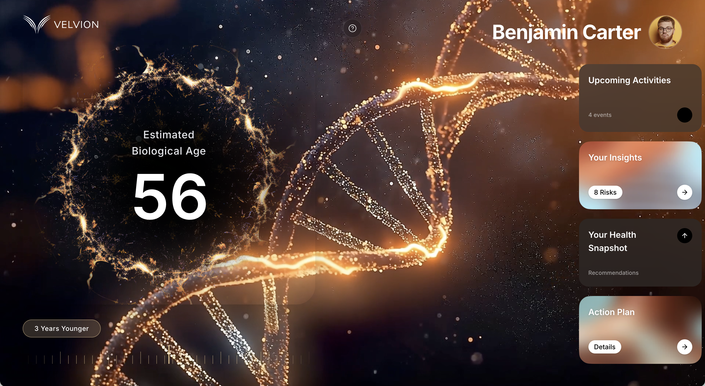 |
| [Bold Studio](collection/bold-studio/) | Prompt | - | 全屏视频背景 + 冲击性三行标题 + 统计数字，创意机构品牌落地页 | 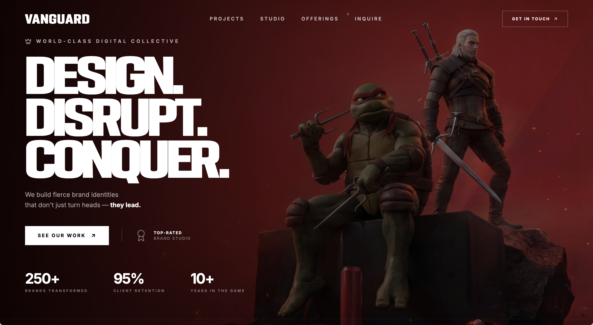 |
| [Contact Cybernetic](collection/contact-cybernetic/) | Prompt | - | 鼠标 Scrub 视频交互 + 动态弹簧多选服务项标签，极客感联系页首屏 | - |
| [CozyPaws](collection/cozy-paws/) | Prompt | - | 弹性过冲单词弹出特效 + 响应式三拼底图视差，温馨宠物商店全屏首屏 | - |
| [Creative Portfolio](collection/creative-portfolio/) | Prompt | - | 三视频无缝淡入淡出切换 + 极致多端自适应排版，个人创意主页首屏 | 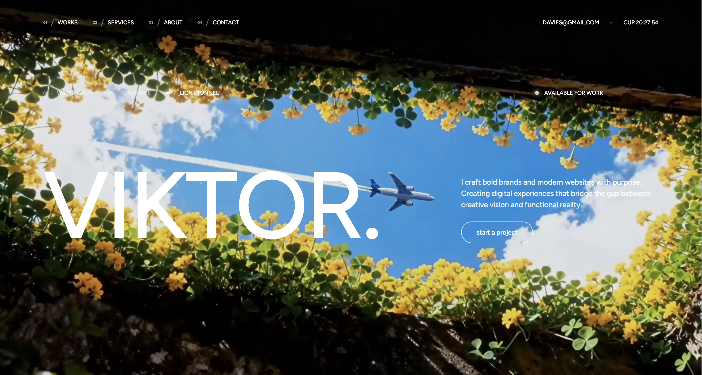 |
| [Immersive Ocean](collection/immersive-ocean/) | Prompt | - | 电影级深海视频背景 + 响应式折叠导航 + 缓动上滑交错文字动效，Foldcraft 创意工作室首屏 | 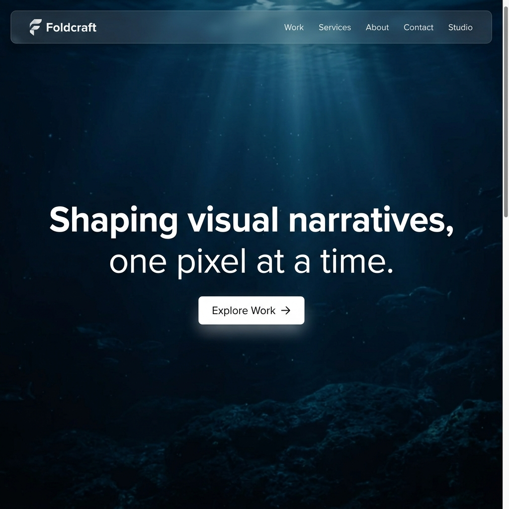 |
| [IntelligentX](collection/intelligent-x/) | Prompt | - | 巨型标题与异形视觉符号混排 + 深层渐变遮罩视频，极简毛玻璃医疗首屏 | - |
| [Interactive Discovery](collection/interactive-discovery/) | Prompt | - | 光标跟随聚光灯揭示双层图片，地质品牌全屏暗色 Hero | 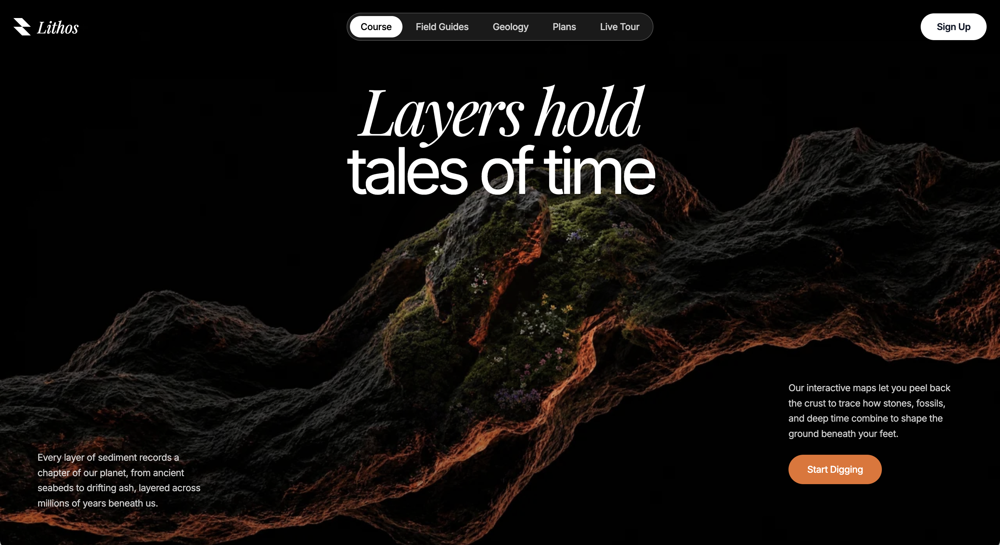 |
| [Luxury Hero](collection/luxury-hero/) | Prompt | - | 纯滚动驱动视频播放（Scroll-scrubbed）+ GSAP 视差毛玻璃面板，奢华体验展示页 | 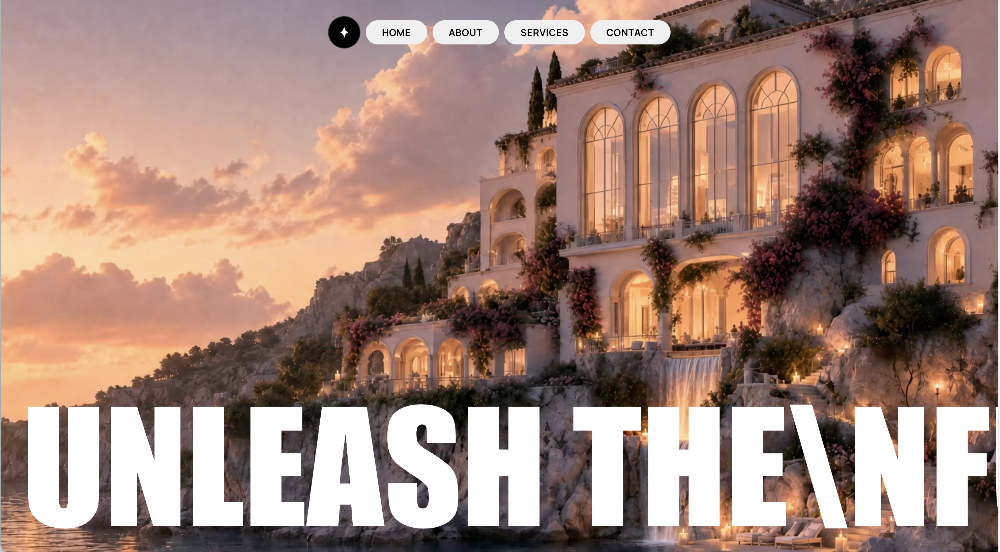 |
| [Organic Odyssey](collection/organic-odyssey/) | Prompt | - | 电影感微观生态背景 + 极致 Liquid Glass 液态玻璃按钮，自然美学展示页 | 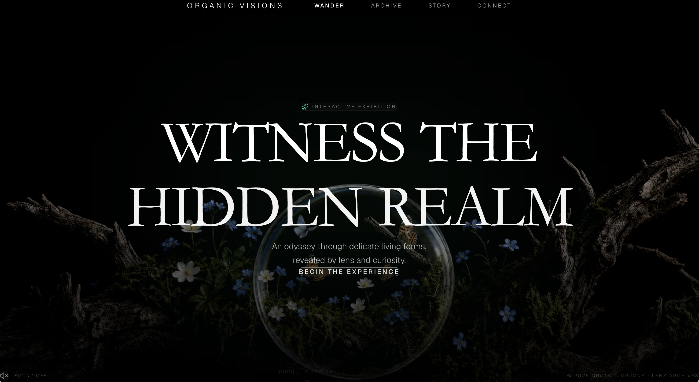 |
| [Portal](collection/portal/) | Prompt | - | CSS Mask 底部模糊渐隐 + Liquid Glass + 10 级错落入场动效，影视平台全屏首屏 | - |
| [Retro-Futurist](collection/retro-futurist/) | Prompt | - | 鼠标横向滑动控制视频交互 + 纯手写打字机特效，极客风复古科幻展示页 | 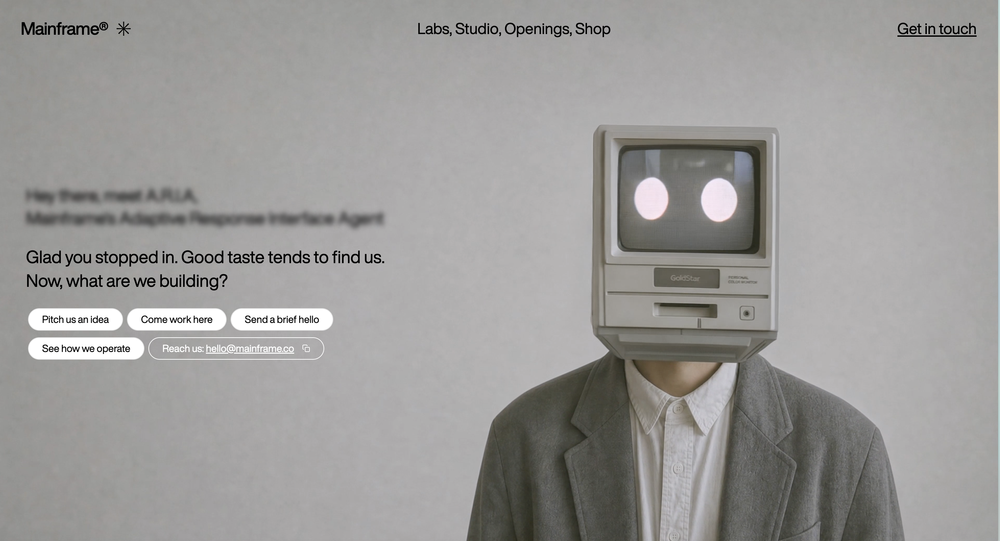 |
| [Securify Data Security](collection/securify-data-security/) | Prompt | - | 巨大错落排版 + 数据统计悬浮块 + 背景视频环绕，数据安全 SaaS 首屏 | 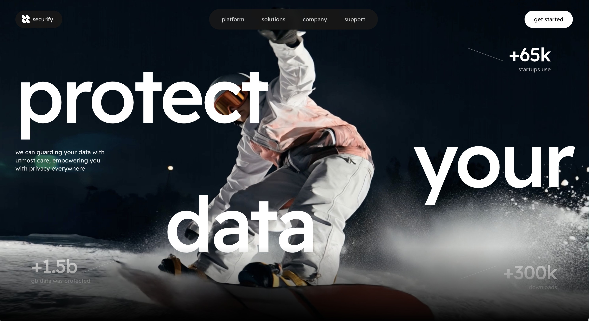 |
| [Stillmind](collection/stillmind/) | Prompt | - | 4 视频切换 + Liquid Glass UI + 漂浮 PNG 叠层，正念 App 全屏 Hero | 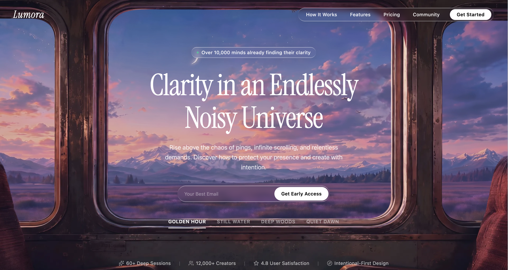 |
| [TechForward](collection/techforward/) | Prompt | - | 极简黑白全屏视频 + Framer Motion 动画 + 纯 CSS，神经科技品牌风格 | 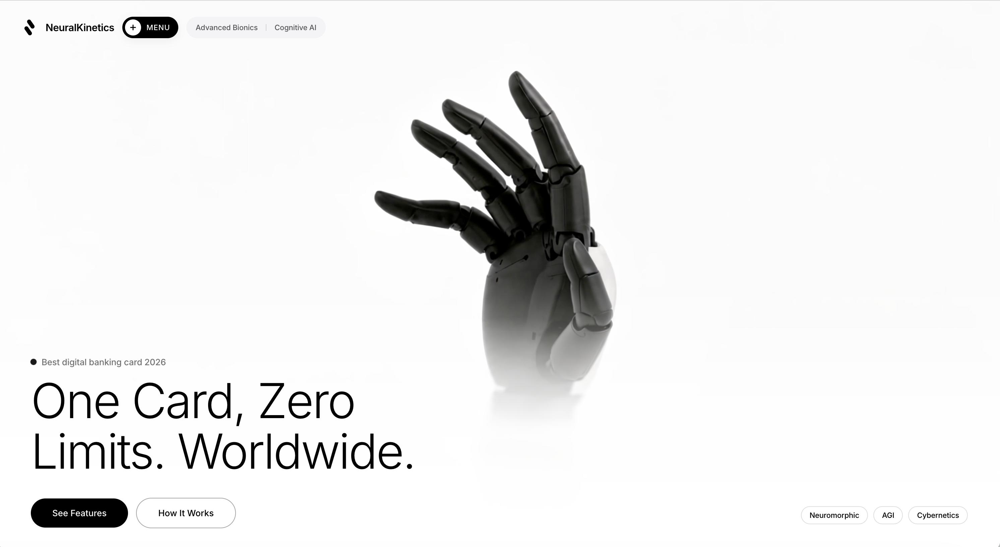 |
| [VaultShield Hero](collection/vault-shield-hero/) | Prompt | - | 密码管理应用的响应式全屏英雄区域，包含背景视频、Framer Motion动画和自定义SVG Logo | - |
| [VEX Venture](collection/vex-venture/) | Prompt | - | 极简创投全屏展示页，无滤镜原生视频背景 + 纯原生精细错落排版动效 | 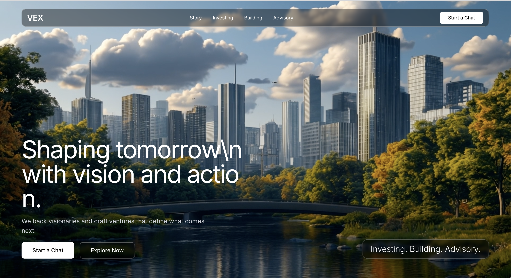 |
| [Vision Reveal](collection/vision-reveal/) | Source Code | - | 瓦片阵列入场 + 光标聚光灯揭示双层图片，纯 HTML/CSS/JS 个人创意工作室展示页 | 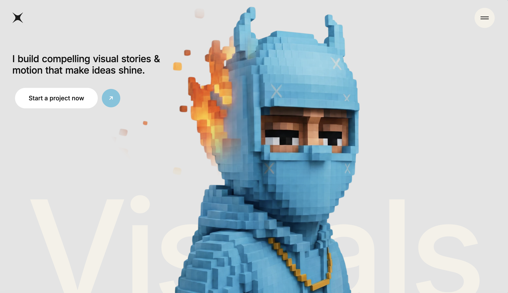 |
| [Wellbeing OS](collection/wellbeing-os/) | Prompt | - | 奢华质感液体玻璃描边 + 悬浮级 Hover 下拉菜单 + 动态滑出移动端导航，flowpath 健康 SaaS 平台首屏 | - |
| [Wellness Balance](collection/wellness-balance/) | Prompt | - | 逐词揭示排版动效 + 非对称网格底栏与自动轮播卡片，极简自然风健康补充剂首屏 | - |
| [Wellness Devicex](collection/wellness-devicex/) | Prompt | - | 5层 Z-index 视觉架构 + Canvas 动态聚光灯遮罩透视视频，影视级暗黑系智能穿戴首屏 | - |

#### Footer Sections

现代页脚导航区块与结尾行动号召（CTA）区域。

| 名称 | 类型 | 演示 | 说明 | 预览 |
|------|------|------|-------------|---------|
| [Heritage Grove](collection/heritage-grove/) | Prompt | - | 单文件无依赖典雅东方水墨风全视口页脚，茶青水墨山水视频背景、Cormorant Garamond衬线字标与5级响应式流式布局 | - |
| [Tenlas Footer](collection/tenlas-footer/) | Prompt | - | 暗黑风 CTA + 极具设计感页脚，带平滑滚动 Fade-up 动效与 SVG 对齐超大文本 | - |
| [Wayfinder](collection/wayfinder/) | Prompt | [HTML](collection/wayfinder/index.html) | Meridian 单屏复古版画全视口页脚——石拱高架桥与马车绿墨手绘视频背景、mix-blend-mode: multiply 无缝融合、Fraunces 衬线字标、罗盘矢量 Logo 与响应式导航网格 | - |

#### Contact Sections

联系我们表单区块，专注于输入交互、状态反馈与表单验证。

| 名称 | 类型 | 演示 | 说明 | 预览 |
|------|------|------|-------------|---------|
| [Build With Us](collection/build-with-us/) | Prompt | - | 全屏视频背景 + 物理材质表单卡片 + 服务选项标签多选 + 提交成功状态切换 | - |

### UI 组件

独立交互组件、3D 卡片动效与可复用视觉元素。

#### UI Components & Effects

独立可复用 UI 组件、3D 实体卡片轮播与滚动展开动效。

| 名称 | 类型 | 演示 | 说明 | 预览 |
|------|------|------|-------------|---------|
| [Animated Cards](collection/animated-cards/) | Prompt | - | 3D 悬浮银行卡片圆柱轮播，支持鼠标视差倾斜、实体厚度切片与双面翻转卡面 | - |
| [Scroll Expansion Hero](collection/scroll-expansion-hero/) | Source Code | - | 滚轮与触控驱动的沉浸式媒体展开组件，支持视频与图片平滑放大、文字视差混合与双模态切换 | - |

## 项目结构

```text
awesome-web-prompts/
├── README.md                  # 中文主页（自动构建）
├── README_EN.md               # 英文主页（自动构建）
├── CONTRIBUTING.md            # 贡献指南
├── package.json               # lint / build / check / new 脚本
├── config/
│   └── taxonomy.json          # 分类体系与双语文案单一数据源
├── templates/
│   └── entry/                 # 新条目脚手架模板
├── catalog/                   # 自动生成的索引产物
│   ├── index.json             # 机器可读条目注册表
│   └── demos.md               # 可运行 HTML 演示清单
├── scripts/                   # 校验、构建与脚手架工具链
└── collection/                # 扁平化条目仓库（按 slug 存放）
    └── <slug>/
        ├── README.md          # YAML frontmatter 元数据 + 说明文档
        ├── prompt.md          # 提示词正文或源码
        ├── preview.png        # 效果预览图（可选）
        └── index.html         # 独立可运行演示（可选）
```

## 如何使用

**Prompt 条目：**
1. 打开对应条目目录下的 `prompt.md` 复制提示词
2. 粘贴到 Claude、ChatGPT、Gemini 或 Cursor 等 AI 工具中生成网页代码

**Source Code / HTML Demo 条目：**
1. 若条目包含 `index.html`，可直接在浏览器打开预览效果
2. 或复制 `prompt.md` 中的源码作为项目起点进行二次开发

## 贡献

欢迎提交优质网页提示词与可运行演示！请查看 [CONTRIBUTING.md](CONTRIBUTING.md) 了解规范与脚手架用法。

## Star History

[](https://star-history.com/#DexZane/awesome-web-prompts&Date)

## License

[MIT](LICENSE)
