# Awesome Web Prompts

> A curated collection of web development resources — AI prompts, ready-to-use source code, and runnable HTML demos.

[](https://awesome.re)

[中文](README.md) | English | [Runnable Demos](catalog/demos.md) | [JSON Registry](catalog/index.json)

## About

Currently curating **84** entries (**57** Full Pages · **25** Page Sections · **2** UI Components), including **19** runnable `index.html` demos.

- **Prompt** — Structured instructions for AI coding tools (Claude, GPT, Gemini, Cursor) to generate complete web UIs
- **Source Code** — Ready-to-run web implementations you can preview directly or build upon

## Categories

- **Full Pages**: [Landing Pages](#landing-pages) (8) · [AI, SaaS & Tech](#ai-saas-tech) (9) · [Creative, 3D & Motion](#creative-3d-motion) (8) · [Portfolio, Agency & Culture](#portfolio-agency-culture) (13) · [Brand, Commerce & Lifestyle](#brand-commerce-lifestyle) (8) · [Fintech, Mobility & Industry](#fintech-mobility-industry) (5) · [Auth, Onboarding & 404](#auth-onboarding-404) (6)
- **Page Sections**: [Hero Sections](#hero-sections) (21) · [Footer Sections](#footer-sections) (3) · [Contact Sections](#contact-sections) (1)
- **UI Components**: [UI Components & Effects](#ui-components-effects) (2)

## Index

### Full Pages

Complete single- or multi-section pages covering full-viewport narratives, landings, and utility flows.

#### Landing Pages

Full multi-section landing pages covering hero, features, showcases, and footer.

| Name | Format | Demo | Description | Preview |
|------|------|------|-------------|---------|
| [3D Story](collection/3d-story/) | Source Code | - | Scroll-driven video frame scrubbing + particle system + card reveal; immersive 3D framework marketing page | 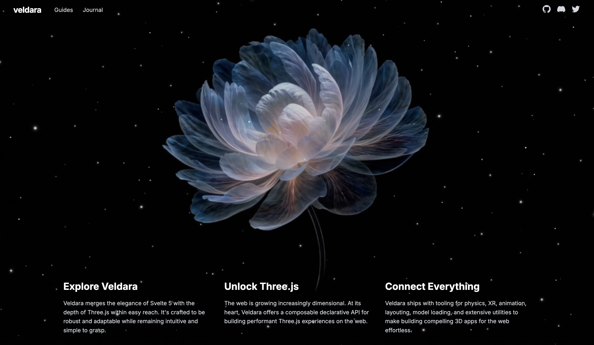 |
| [AI Designer Portfolio](collection/ai-designer-portfolio/) | Prompt | - | Mouse-trail GIF particles + parallax image + auto-scrolling testimonial carousel; designer portfolio landing | - |
| [Health Portal](collection/health-portal/) | Prompt | - | Masked cards mosaic effect + staggered reveals; single-page dental medical landing page | 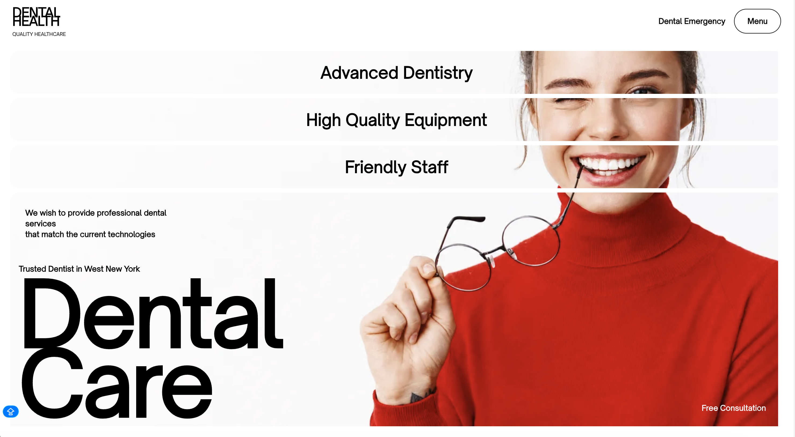 |
| [Innovation](collection/innovation/) | Prompt | - | Advanced liquid glass + vanilla JS seamless video crossfade to black; 5-section enterprise landing page | - |
| [Orbis NFT](collection/orbis-nft/) | Prompt | - | Advanced liquid glass effect + global texture overlay + deep space video grid, dark mode NFT landing page | - |
| [Prisma Creative Studio](collection/prisma-creative-studio/) | Prompt | - | Cinematic dark mode + SVG noise background + words pull-up animation; 3-section creative studio landing page | 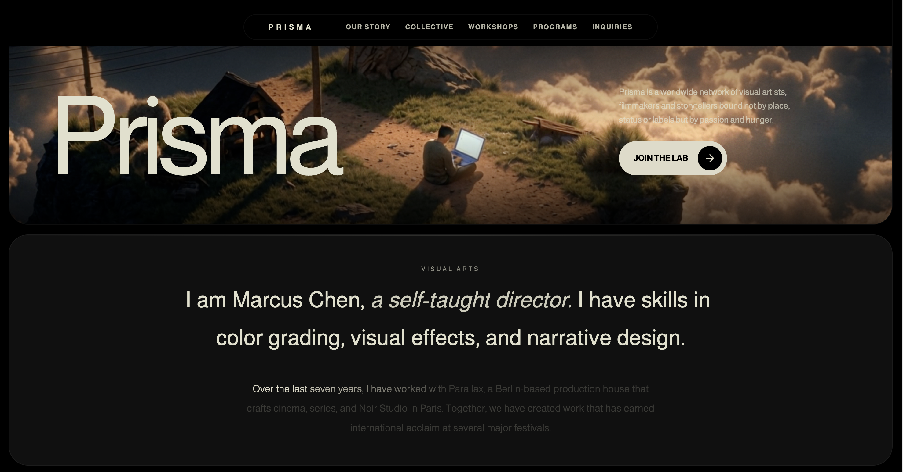 |
| [SkyElite Private Jets](collection/skyelite-private-jets/) | Prompt | - | Premium private jet landing page with video background and overlapping typography | - |
| [USD Halo](collection/usd-halo/) | Prompt | - | Fintech stablecoin landing page, rounded video Hero + brand font marquee | - |

#### AI, SaaS & Tech

AI systems, SaaS cloud platforms, data intelligence, cybersecurity, and modern tech product pages.

| Name | Format | Demo | Description | Preview |
|------|------|------|-------------|---------|
| [ADHD Planner (Drift)](collection/adhd-planner/) | Prompt | - | Calm and ADHD-friendly planner app Drift landing page with fullscreen video hero, warm cream About section, and sticky scroll-linked feature cards. | - |
| [Agent Wave (Vesper.ai)](collection/agent-wave/) | Prompt | - | Single-file dependency-free pure black single-viewport AI landing page with liquid metal navigation pills, Instrument Serif typography, and responsive stats footer. | - |
| [AI Runtime](collection/ai-runtime/) | Prompt | - | Single-viewport immersive video background AI landing page featuring retro dot-matrix typography and animated stat counters. | - |
| [Cyber Layer](collection/cyber-layer/) | Prompt | - | Self-contained single-viewport cybersecurity dark landing page with dual color-graded LUT video background, Space Grotesk typography, and choreographed WAAPI entrance timeline. | - |
| [Cyber Ronin](collection/cyber-ronin/) | Prompt | - | Self-contained full-viewport cyberpunk hero section featuring cursor spotlight dual-image reveal, word-pull-up typography, and 6-tier responsive architecture. | - |
| [Fastshot](collection/fastshot/) | Prompt | - | Self-contained single-viewport AI app builder Fastshot landing page with dawn video background, pixel-precise composer card, and 3-tier responsive architecture. | - |
| [Intelligent Performance](collection/intelligent-performance/) | Prompt | - | Single-file zero-dependency SaaS marketing stage, responsive dual CloudFront video backgrounds, LED dot matrix font generator, and three 429x554 glass metric cards | - |
| [Quantum Core (Apogee)](collection/quantum-core/) | Prompt | - | Deep space nebula video background + glassmorphic revenue growth card + pure CSS bar grow animation, Apogee data intelligence hero landing page | - |
| [Signal ID](collection/signal-id/) | Prompt | - | A full-viewport dark hero landing page for a technology brand, featuring a right-aligned signup form and a cinematic background video. | - |

#### Creative, 3D & Motion

Immersive 3D experiences, scroll-driven editorial storytelling, space visuals, and experimental motion pages.

| Name | Format | Demo | Description | Preview |
|------|------|------|-------------|---------|
| [Autumn Fox](collection/autumn-fox/) | Prompt | [HTML](collection/autumn-fox/index.html) | FENNEC AI automation full-screen 3D hero landing page featuring interactive Three.js autumn fox model, floating bob parallax, warm video background, and morphing pill drawer menu | - |
| [ConSentinel](collection/consentinel/) | Prompt | - | Single-file zero-dependency digital security hero featuring --u reference unit scaling, WAAPI entrance choreography, and aspect-ratio driven responsive geometry | - |
| [Nebula Hero](collection/nebula-hero/) | Prompt | [HTML](collection/nebula-hero/index.html) | Orbit space product full-viewport hero landing page featuring a rigid 1563×1006 --u scaling system, ringed planet vector SVG, 9s looping nebula video, dual-line text mask reveal, and a 1.7s choreographed entrance timeline | - |
| [Runway Lookbook](collection/runway-lookbook/) | Prompt | [HTML](collection/runway-lookbook/index.html) | Maison Vell fashion runway lookbook full-viewport page featuring single-variable p driving, 7-stop depth table interpolation, dual SVG sprite sheet cropping, and fluid drag-snap synchronization | - |
| [Space Planet](collection/space-planet/) | Prompt | - | Single-file zero-dependency immersive space hero with seamless 3-planet video switching, --u reference unit scaling, and interactive planet cut-outs | - |
| [Space Voyage](collection/space-voyage/) | Prompt | [HTML](collection/space-voyage/index.html) | Cinematic space portal experience with video preloader, canvas fake-perspective rounded-rect portal, pointer tilt, freeze-frame transition, and Mars/Earth/Venus state machine | - |
| [Sparkform](collection/sparkform/) | Prompt | - | A highly creative landing page featuring stacked 3D text effects, scroll-driven typography animations, and an infinite marquee. | - |
| [Vectrus Energy](collection/vectrus-energy/) | Prompt | - | Cinematic scroll-driven video storytelling website with WebCodecs + MP4Box frame-bank decoding for smooth scrubbing, Helvetica Neue ME typography, and a 500vh narrative scroll track. | - |

#### Portfolio, Agency & Culture

Personal portfolios, creative agencies, cultural museum exhibitions, art galleries, and photography archives.

| Name | Format | Demo | Description | Preview |
|------|------|------|-------------|---------|
| [3D Portfolio](collection/3d-portfolio/) | Prompt | - | 3D creator portfolio with magnetic hover, infinite marquee, and sticky stacking cards | 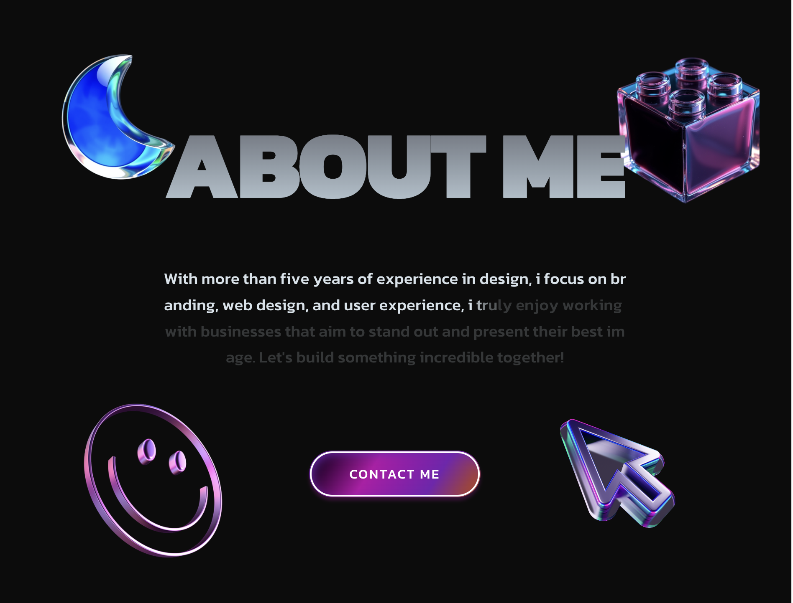 |
| [Atrium MTL](collection/atrium-mtl/) | Prompt | [HTML](collection/atrium-mtl/index.html) | ATRIUM MTL Montreal brutalist architecture and photography archive full-viewport hero featuring floating white header card, oversized typography text-mask reveal, 6-column staggered seamless infinite mosaic marquee, and choreographed WAAPI handoff | - |
| [AXON](collection/axon/) | Prompt | [HTML](collection/axon/index.html) | AXON motion research hub full-screen dark landing page featuring a 262k GPGPU particle cloud sculpted by SDF, cursor fluid simulation turbulence, and monospace editorial UI | - |
| [Digital Director](collection/digital-director/) | Prompt | - | Pixel-perfect full-viewport portfolio landing page for Digital Director Adam Roberts with basis33 bitmap font, background video, and award chips | - |
| [Gold Standard](collection/gold-standard/) | Prompt | [HTML](collection/gold-standard/index.html) | SOSCALE gold standard full-viewport hero landing page featuring SVG evenodd text cutout video mask, rigid 1280 --u scaling system, focal-point video positioning algorithm, and Web Animations API choreographed entrance | - |
| [Nature Portfolio](collection/nature-portfolio/) | Prompt | [HTML](collection/nature-portfolio/index.html) | Wildlife photography archive with Fibonacci photo sphere, 16vh scroll dolly, FLIP lightbox, flat grid, fullscreen menu, and custom cursor | - |
| [Neo Museum (NHM)](collection/neo-museum/) | Prompt | - | Immersive Natural History Museum (NHM) multi-section website featuring SVG polygon letter entrance, SVG filter sand-dissolve chapter transitions, and dark/light section flow. | - |
| [Parallax](collection/parallax/) | Prompt | [HTML](collection/parallax/index.html) | PARALLAX full-viewport portfolio landing page featuring 1280x800 dual scale system (--sc / --u), 12 precision SVG arc ring lines, choreographed WAAPI entrance timeline, and responsive micro-interactions | - |
| [Playful Idea](collection/playful-idea/) | Prompt | - | Single-page creative studio footer with lavender character video background, pointer gaze scrubbing interaction, and 3-column minimalist layout | - |
| [Portfolio Cosmic](collection/portfolio-cosmic/) | Prompt | - | Premium dark portfolio with HLS background and complex GSAP scroll parallax | - |
| [Print Ring (OMBRY)](collection/print-ring/) | Prompt | [HTML](collection/print-ring/index.html) | OMBRY night-portrait photography portfolio on a zero-dependency WebGL2 3D print ring — 14 cloth-physics prints swaying and flaring with speed, pitch-to-overhead drag, rail-straightening project view, ink-soak photo transition, and liquid-drop theme wipe | - |
| [Shelf Hero](collection/shelf-hero/) | Prompt | [HTML](collection/shelf-hero/index.html) | Leon Vasari filmography 3D VHS tape shelf full-viewport hero featuring endless looping rack, 3D turning active cover, ink-blot bleed detail transition, and physics spring interactions | - |
| [Talent Collective](collection/talent-collective/) | Prompt | - | Minimalist fullscreen creative studio talent showcase featuring seamlessly transitioning background portraits, subtle gradients, and pure CSS interactions. | - |

#### Brand, Commerce & Lifestyle

E-commerce, food & drink, luxury real estate, travel planning, creator platforms, and sustainability sites.

| Name | Format | Demo | Description | Preview |
|------|------|------|-------------|---------|
| [AI Trip Planner (Wandor)](collection/ai-trip-planner/) | Prompt | - | Full-viewport AI travel hero page for Wandor with video background, frosted glass prompt card, and Special Elite branding | - |
| [Harborlux](collection/harborlux/) | Prompt | [HTML](collection/harborlux/index.html) | HARBORLUX luxury penthouse 7.4-second cinematic intro hero — black lacquer doors opening, aerial-to-skyline tilt video transition, multi-layer parallax depth, seamless rain loop crossfading, and letter-by-letter rising headline. | - |
| [Moo-Moo Oat Milk](collection/moo-moo-oat-milk/) | Prompt | [HTML](collection/moo-moo-oat-milk/index.html) | MOO-MOO oat milk 2-section brand landing page featuring a rainbow typed intro, real-time Three.js 3D gable-top carton, giant invisible-wheel flavour carousel, and a pinned cream-dome scroll ring with cap pop, rising straw, and bubbles | - |
| [Protein Bars](collection/protein-bars/) | Prompt | [HTML](collection/protein-bars/index.html) | Stride plant protein bar 4-section landing page with a real-time 3D bar wrapper carousel, one travelling bar that flips through the inside section, storms through its own ingredients, and lands exactly on its shop card, plus a 3-pack builder | - |
| [Reelmark](collection/reelmark/) | Prompt | [HTML](collection/reelmark/index.html) | Reelmark short-form video creator marketplace full-viewport hero featuring 1440x1080 unit metrics, internal cylinder curved carousel, single-video 5x2 sprite atlas, and momentum fling physics | - |
| [Smoothie Slider](collection/smoothie-slider/) | Prompt | [HTML](collection/smoothie-slider/index.html) | Blendy real fruit smoothie 4-flavour full-viewport hero slider featuring pastel backdrops, CSS sprite background crops, measured panel wipe transitions, and parallax layers | - |
| [TrueEarth](collection/true-earth/) | Prompt | - | Single-file zero-dependency ocean conservation nonprofit hero, aerial reef video card, image-filled headline highlight, and frosted glass nav sheet | - |
| [Vertex](collection/vertex/) | Prompt | - | Single-file zero-dependency e-commerce SaaS hero with 1172x657 scaled canvas, 37-card 3D perspective cylinder ring, and bottom-glow buttons | - |

#### Fintech, Mobility & Industry

Fintech payment flows, electric mobility, precision manufacturing, and freight logistics pages.

| Name | Format | Demo | Description | Preview |
|------|------|------|-------------|---------|
| [Cordex](collection/cordex/) | Prompt | - | Single-file zero-dependency industrial cable protection landing page featuring All-Intra video scroll-scrubbing and multi-scene spec card linkage | - |
| [Freight Scroll Hero](collection/freight-scroll-hero/) | Prompt | [HTML](collection/freight-scroll-hero/index.html) | Full-viewport scroll-driven freight logistics hero featuring sticky keyframe-dense aerial train video scrub, mirrored axis layout, two-part camera climb mapping, and seamless cloud transition to customer trust section | - |
| [Logistics Freight](collection/logistics-freight/) | Prompt | [HTML](collection/logistics-freight/index.html) | Logistics Freight modern supply chain full-viewport hero landing page featuring aerial freight train video background, @font-face font-metric overrides, train-axis mirrored dual feature layout, and 1.8s single entrance animation | - |
| [Remit Race](collection/remit-race/) | Prompt | - | Dark competition-style mobile mockup with 3D globe video + layered countdown bar | - |
| [Veyra Electric](collection/veyra-electric/) | Prompt | - | Interactive electric concept car landing page featuring 1672:941 shared image plane, multi-video off-DOM canvas decoding, and paint/wheel appearance dock | - |

#### Auth, Onboarding & 404

Authentication, user onboarding flows, and custom 404 error pages.

| Name | Format | Demo | Description | Preview |
|------|------|------|-------------|---------|
| [404 Planet](collection/404-planet/) | Prompt | - | Locked 100vh cloud hosting error page with looping video background, liquid glass button, and glowing 404 text | - |
| [Aurora Onboard](collection/aurora-onboard/) | Prompt | - | Split-screen layout + unmasked pure video hero + staggered entrance animations, minimalist B&W sign up | - |
| [Fun 404 Page](collection/fun-404-page/) | Prompt | - | Dynamically scaled giant background text + handcrafted staggered drawer menu, bright children's brand 404 | - |
| [Nexto 404](collection/nexto-404/) | Prompt | - | Locked 100vh viewport + layered spaceship background + slow float animation, sci-fi error page | - |
| [Real-Time Alerts (Signal)](collection/real-time-alerts/) | Prompt | - | Self-contained dependency-free single HTML/CSS/JS login page with diving peregrine falcon video hero, pixel-calibrated 3-mode responsive engine, and WAAPI entrance timeline. | - |
| [Skybridge 404](collection/skybridge-404/) | Prompt | - | Minimalist precision 404 error page with full-viewport 100% opacity video background, pixel SVG logo, and gradient 404 numerals | - |

### Page Sections

Modular hero, footer, and contact sections designed to drop into full pages.

#### Hero Sections

First-viewport hero sections featuring full-bleed video, liquid glass, cursor reveals, and bold typography.

| Name | Format | Demo | Description | Preview |
|------|------|------|-------------|---------|
| [Bio-Age Dashboard](collection/bio-age-dashboard/) | Prompt | - | Slow rotating aura + infinite ticker ruler + expandable hover cards; health data dashboard hero | 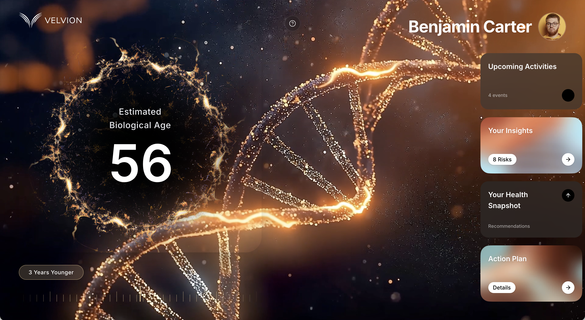 |
| [Bold Studio](collection/bold-studio/) | Prompt | - | Full-screen video bg + three-line impact headline + stat counters; creative agency landing | 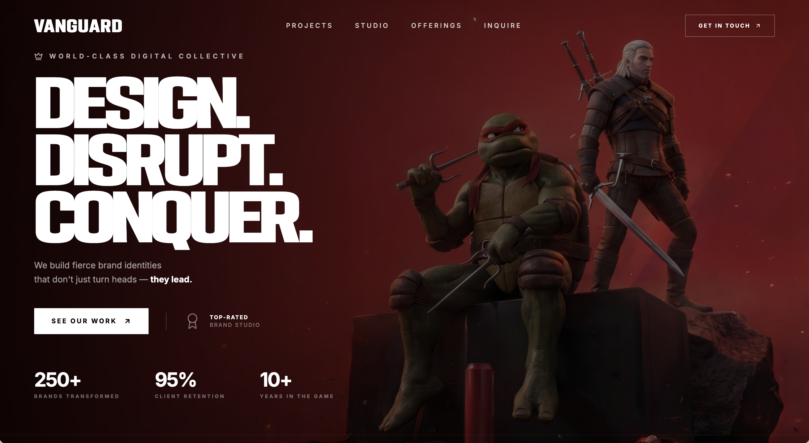 |
| [Contact Cybernetic](collection/contact-cybernetic/) | Prompt | - | Mouse-scrub video interaction + spring-animated multi-select pills; cybernetic contact hero | - |
| [CozyPaws](collection/cozy-paws/) | Prompt | - | Bouncy overshoot word pop animation + responsive 3-panel footer image parallax, cozy pet store hero | - |
| [Creative Portfolio](collection/creative-portfolio/) | Prompt | - | 3-video crossfade switcher + precise responsive typography; personal creative hero | 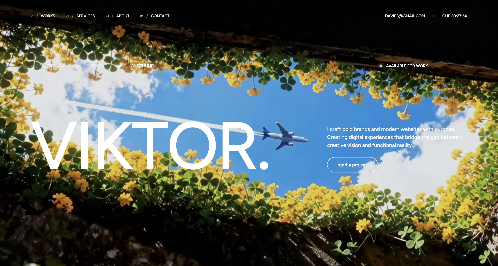 |
| [Immersive Ocean](collection/immersive-ocean/) | Prompt | - | Cinematic deep ocean video background + responsive collapsible nav + staggered fade-up text animations; Foldcraft studio hero | 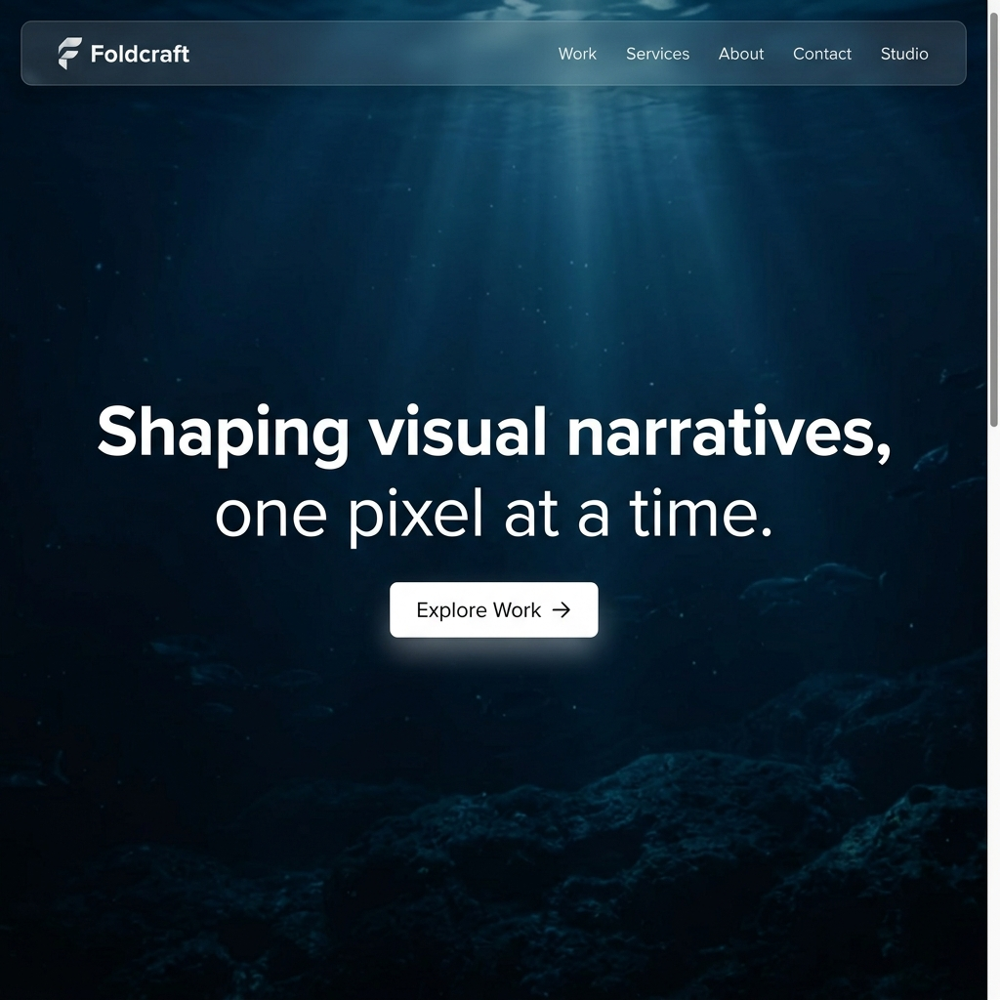 |
| [IntelligentX](collection/intelligent-x/) | Prompt | - | Giant typography mixed with inline pill visual elements + deep masked video, minimalist glassmorphic medical hero | - |
| [Interactive Discovery](collection/interactive-discovery/) | Prompt | - | Cursor-following spotlight reveals a second image; dark geology brand hero | 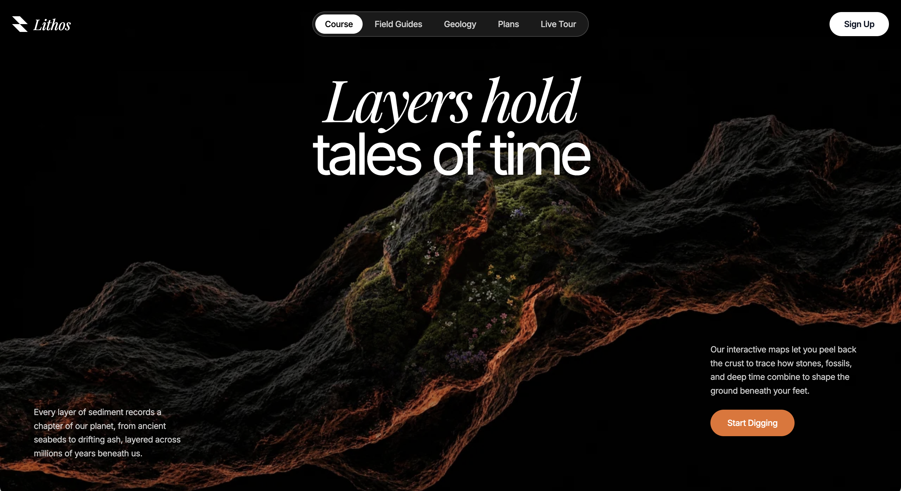 |
| [Luxury Hero](collection/luxury-hero/) | Prompt | - | Scroll-scrubbed background video + GSAP parallax glass panel; luxury experience hero | 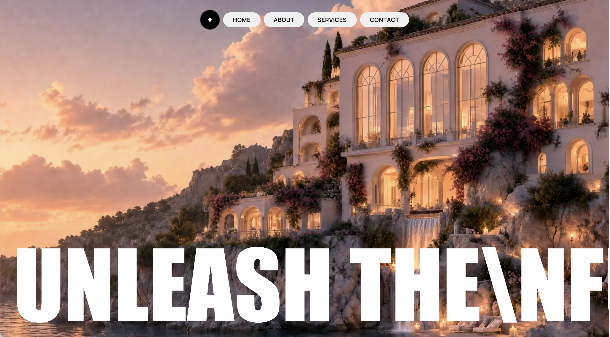 |
| [Organic Odyssey](collection/organic-odyssey/) | Prompt | - | Cinematic microscopic background + precise liquid glass button; nature aesthetic hero | 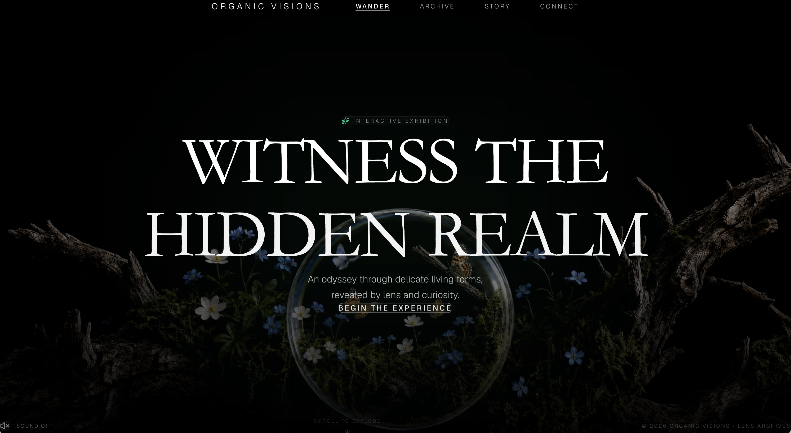 |
| [Portal](collection/portal/) | Prompt | - | CSS Mask bottom blur fade + Liquid Glass + 10-level staggered entrance, cinematic full-screen hero | - |
| [Retro-Futurist](collection/retro-futurist/) | Prompt | - | Mouse-scrub interactive video background + custom typewriter effect; retro-futurist agency hero | 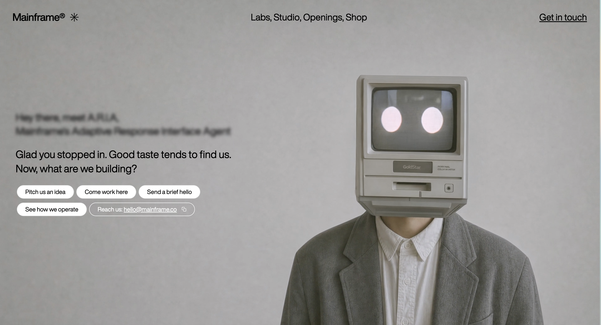 |
| [Securify Data Security](collection/securify-data-security/) | Prompt | - | Giant staggered typography + floating stats + background video; data security SaaS hero | 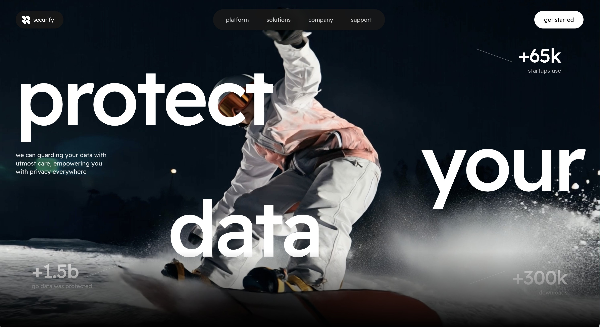 |
| [Stillmind](collection/stillmind/) | Prompt | - | 4-video switcher + Liquid Glass UI + floating PNG overlay; mindfulness app fullscreen hero | 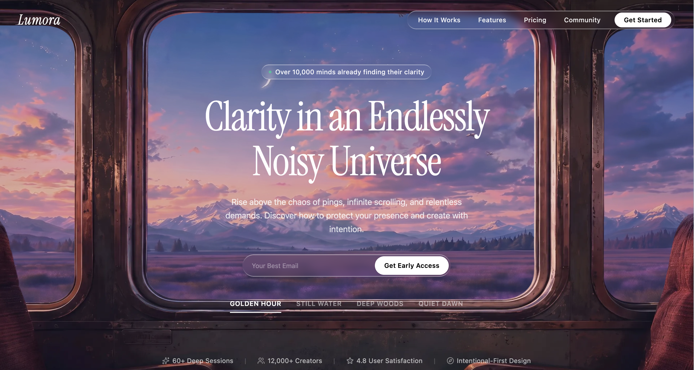 |
| [TechForward](collection/techforward/) | Prompt | - | Minimal black-and-white video hero + Framer Motion animations + plain CSS; neuro-tech brand | 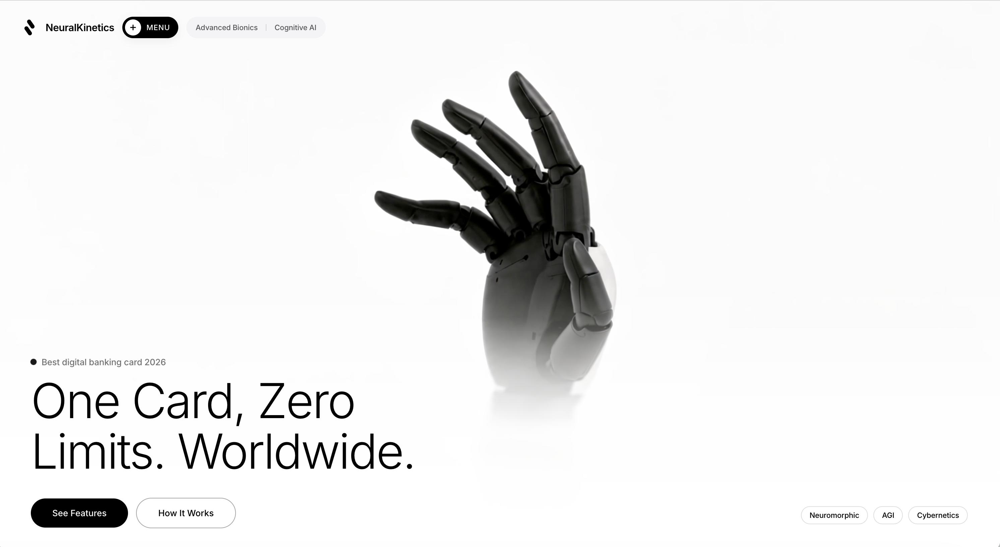 |
| [VaultShield Hero](collection/vault-shield-hero/) | Prompt | - | Responsive fullscreen hero section for a password manager app, featuring a background video, Framer Motion animations, and a custom SVG logo | - |
| [VEX Venture](collection/vex-venture/) | Prompt | - | Minimalist venture hero page; raw video background + precise native staggered animations | 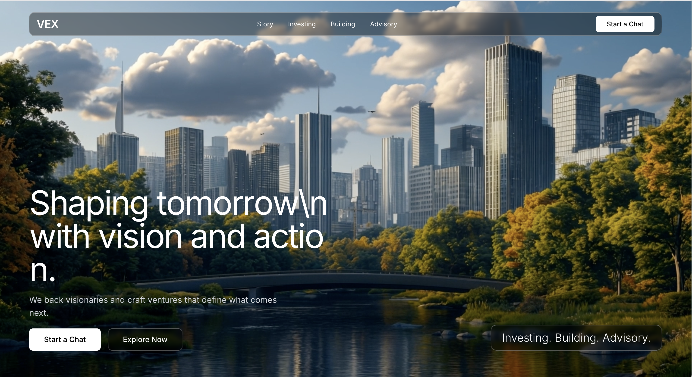 |
| [Vision Reveal](collection/vision-reveal/) | Source Code | - | Tile split entrance + cursor spotlight reveal; pure HTML/CSS/JS creative studio hero | 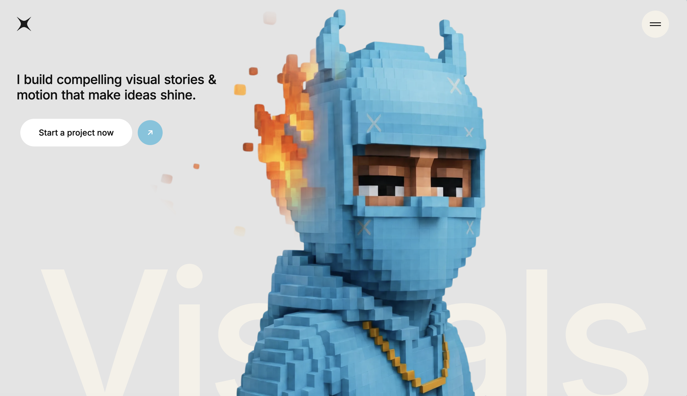 |
| [Wellbeing OS](collection/wellbeing-os/) | Prompt | - | High-end Liquid Glass borders + responsive hover-triggered dropdown menu + smooth sliding mobile drawer, flowpath wellness SaaS hero | - |
| [Wellness Balance](collection/wellness-balance/) | Prompt | - | Word-by-word reveal typography + asymmetric grid footer with auto-carousel, minimalist wellness supplement hero | - |
| [Wellness Devicex](collection/wellness-devicex/) | Prompt | - | 5-layer Z-index architecture + Canvas dynamic spotlight video mask, cinematic dark mode wearable hero | - |

#### Footer Sections

Modern footer navigation sections and closing call-to-action blocks.

| Name | Format | Demo | Description | Preview |
|------|------|------|-------------|---------|
| [Heritage Grove](collection/heritage-grove/) | Prompt | - | Single-file zero-dependency elegant teal ink landscape full-viewport footer, Cormorant Garamond wordmark, and 5 responsive breakpoints | - |
| [Tenlas Footer](collection/tenlas-footer/) | Prompt | - | Dark mode CTA + premium footer with staggered fade-up animations and responsive flush SVG brand text | - |
| [Wayfinder](collection/wayfinder/) | Prompt | [HTML](collection/wayfinder/index.html) | Meridian single-screen vintage engraved illustration full-viewport footer featuring dark green viaduct & stagecoach looping video, multiply blend mode paper integration, Fraunces serif wordmark, compass SVG mark, and responsive nav grid | - |

#### Contact Sections

Interactive contact form sections focused on input states, tags, and submission flows.

| Name | Format | Demo | Description | Preview |
|------|------|------|-------------|---------|
| [Build With Us](collection/build-with-us/) | Prompt | - | Full-screen video background + physical card layout + service tags multi-select + submit success state transition | - |

### UI Components

Standalone interactive UI components, 3D visuals, and reusable micro-interactions.

#### UI Components & Effects

Standalone reusable UI components, 3D volumetric card carousels, and scroll-expansion visuals.

| Name | Format | Demo | Description | Preview |
|------|------|------|-------------|---------|
| [Animated Cards](collection/animated-cards/) | Prompt | - | 3D horizontal cylinder card carousel with mouse parallax tilt, volumetric thickness layers, and dual-face flip | - |
| [Scroll Expansion Hero](collection/scroll-expansion-hero/) | Source Code | - | Wheel and touch-driven immersive scroll-expanding media hero with smooth video/image expansion, text blend parallax, and dual-mode toggle | - |

## Structure

```text
awesome-web-prompts/
├── README.md                  # Chinese index (auto-generated)
├── README_EN.md               # English index (auto-generated)
├── CONTRIBUTING.md            # Contribution guidelines
├── package.json               # lint / build / check / new scripts
├── config/
│   └── taxonomy.json          # Single source of truth for taxonomy & i18n
├── templates/
│   └── entry/                 # Entry scaffolding template
├── catalog/                   # Auto-generated derived indexes
│   ├── index.json             # Machine-readable entry registry
│   └── demos.md               # Runnable HTML demo index
├── scripts/                   # Validation, build & scaffolding CLI
└── collection/                # Flat slug-addressed entry store
    └── <slug>/
        ├── README.md          # YAML frontmatter metadata + documentation
        ├── prompt.md          # Prompt text or source code
        ├── preview.png        # Preview screenshot (optional)
        └── index.html         # Standalone runnable demo (optional)
```

## How to Use

**Prompt entries:**
1. Open `prompt.md` inside an entry folder and copy the prompt text
2. Paste it into Claude, ChatGPT, Gemini, or Cursor to generate the page

**Source Code / HTML Demo entries:**
1. When `index.html` is present, open it directly in a browser to preview
2. Or copy the code from `prompt.md` as a starting point for your project

## Contributing

Contributions are welcome! See [CONTRIBUTING.md](CONTRIBUTING.md) for guidelines and CLI scaffolding.

## Star History

[](https://star-history.com/#DexZane/awesome-web-prompts&Date)

## License

[MIT](LICENSE)
